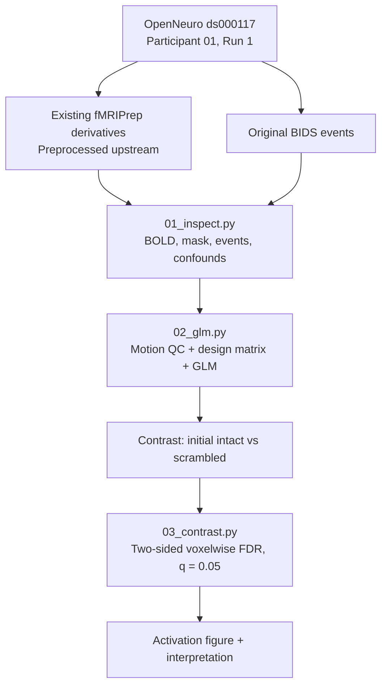
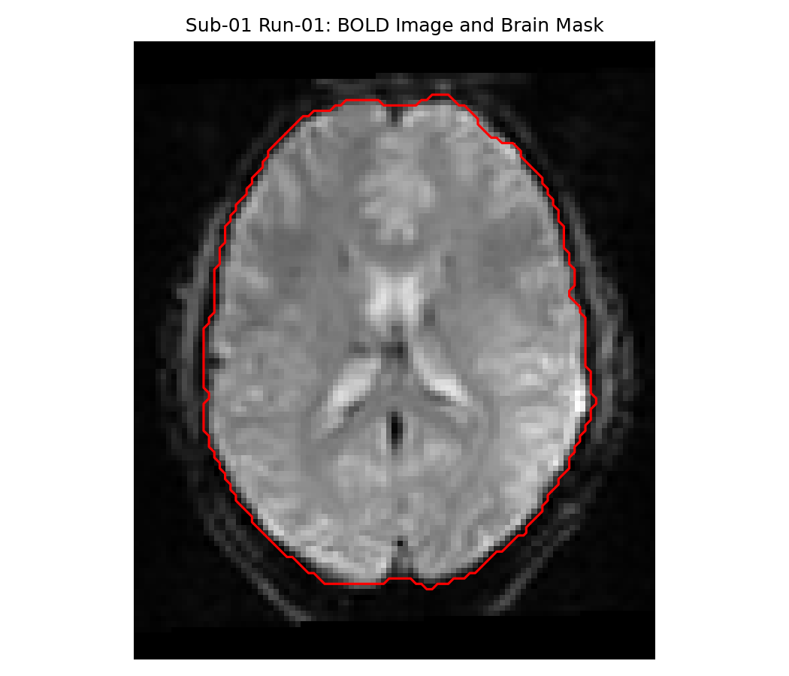
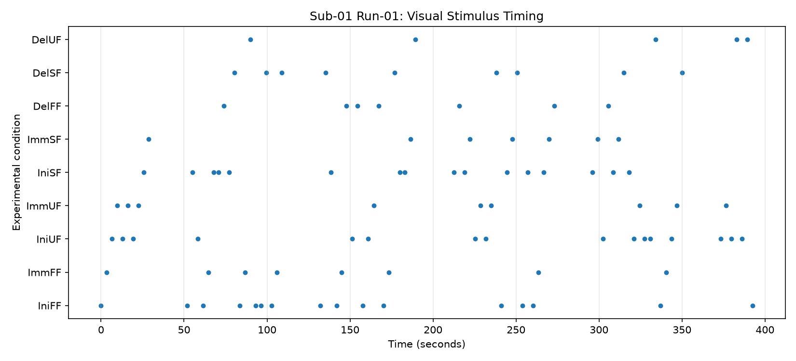
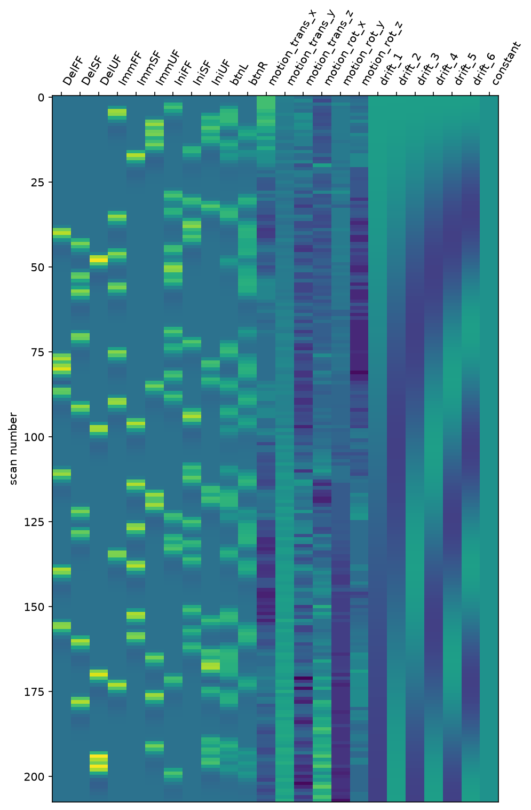
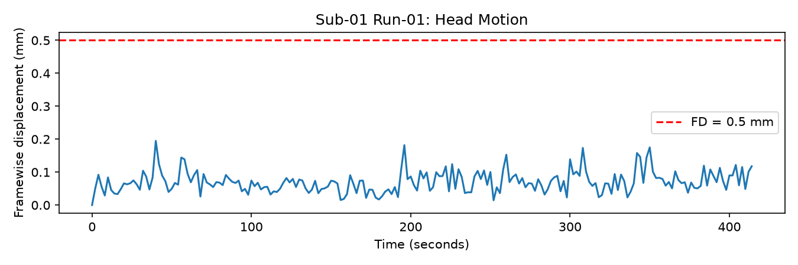
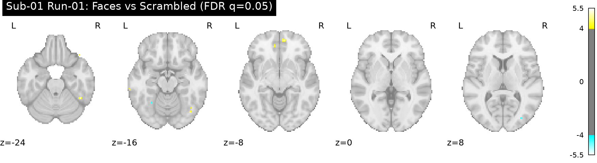

# Task-fMRI Analysis of Face Processing Using Python and Nilearn

A compact, reproducible **task-fMRI GLM demonstration** using preprocessed data from [OpenNeuro ds000117](https://openneuro.org/datasets/ds000117), the Wakeman–Henson face-processing dataset.

**Scope:** One participant (`sub-01`) · One functional run (`run-1`) · One predefined contrast · Three Python scripts.

## Project Snapshot

This repository demonstrates a straightforward task-fMRI analysis workflow:

1. Inspect the BOLD image, brain mask, experimental events, and confounds.
2. Examine motion, construct a first-level GLM design matrix, and fit the model.
3. Estimate the intact-versus-scrambled contrast, correct for voxelwise multiple comparisons, and visualize the result.

The focus is **practical understanding and reproducibility**, not a novel or population-level finding.

## Why This Project Matters

The project connects an experimental question to an interpretable statistical analysis of real fMRI data. It demonstrates basic NIfTI/BIDS data handling, task-event modeling, motion inspection, first-level GLM estimation, contrast testing, and cautious interpretation of statistical brain maps.

## Research Aim

**Question:** Do initially presented intact faces evoke greater modeled BOLD responses than initially presented scrambled faces?

The predefined contrast is:

$$
0.5\,\mathrm{IniFF}+0.5\,\mathrm{IniUF}-\mathrm{IniSF}
$$

`IniFF` = initial famous faces; `IniUF` = initial unfamiliar faces; `IniSF` = initial scrambled faces. Other visual repetition conditions and left/right button responses are represented as separate regressors in the model.

## Visual Workflow



## Key Exploratory Results

The Run 1 analysis tested **247,144 voxels** within its functional brain mask. After **two-sided voxelwise false discovery rate (FDR) correction at q = 0.05**, with no additional cluster-size filter, the results were:

| Result | Value |
|---|---:|
| Volumes | 208 |
| TR | 2 s |
| Resampled voxel size | 2 × 2 × 2 mm |
| Design matrix | 208 rows × 24 columns (full rank) |
| FDR z threshold | **3.982** |
| Positive surviving voxels (intact > scrambled) | **134** |
| Negative surviving voxels (scrambled > intact) | **210** |

The surviving effects are **limited and spatially scattered**. They do not establish a distinct face-selective network or demonstrate population-level effects.

## Example Outputs

**1. BOLD image and brain mask.** An axial slice of the preprocessed functional image with its mask boundary overlaid in red; this is a basic spatial-consistency check, not a full registration assessment.



**2. Visual stimulus timing.** Onsets of the nine visual conditions across Run 1; these events are the basis of the task regressors.



**3. First-level design matrix.** Predicted responses to visual and button events, six motion variables, six cosine drift regressors, and an intercept.



**4. Motion quality control.** Framewise displacement (FD) over time. No Run 1 volume exceeded **FD > 0.5 mm**; this does not exclude other signal artifacts.



**5. FDR-corrected activation map.** Yellow indicates a larger modeled response for initially presented intact faces; cyan indicates a larger response for scrambled faces. The displayed effects survive the specified FDR procedure, but are sparse and not sufficient to localize a face-selective region.



## Data Availability and Preprocessing

The original dataset is publicly available as [OpenNeuro ds000117](https://openneuro.org/datasets/ds000117). **fMRIPrep preprocessing was performed upstream by the derivative-data providers**; it was not run as part of this project. This repository uses the already-preprocessed BOLD image, brain mask, motion confounds, and original event timing file in `MNI152NLin2009cAsym` space (2 mm resampled resolution).

Large imaging inputs and generated NIfTI statistical maps are kept locally rather than committed to GitHub. The scripts expect the following files relative to the repository root:

```text
data/
├── raw/
│   └── sub-01_run-01_events.tsv
└── derivatives/sub-01/ses-mri/func/
    ├── sub-01_ses-mri_task-facerecognition_run-1_desc-confounds_timeseries.tsv
    ├── sub-01_ses-mri_task-facerecognition_run-1_space-MNI152NLin2009cAsym_res-2_desc-brain_mask.nii.gz
    └── sub-01_ses-mri_task-facerecognition_run-1_space-MNI152NLin2009cAsym_res-2_desc-preproc_bold.nii.gz
```

To obtain the four inputs, install the [AWS CLI](https://aws.amazon.com/cli/) and run the following from the repository root in PowerShell:

```powershell
$dest = "data/derivatives/sub-01/ses-mri/func"
New-Item -ItemType Directory -Force $dest, "data/raw" | Out-Null
$source = "s3://openneuro-derivatives/fmriprep/ds000117-fmriprep/sub-01/ses-mri/func"
$prefix = "sub-01_ses-mri_task-facerecognition_run-1_"
aws s3 cp "$source/${prefix}desc-confounds_timeseries.tsv" "$dest/" --no-sign-request
aws s3 cp "$source/${prefix}space-MNI152NLin2009cAsym_res-2_desc-brain_mask.nii.gz" "$dest/" --no-sign-request
aws s3 cp "$source/${prefix}space-MNI152NLin2009cAsym_res-2_desc-preproc_bold.nii.gz" "$dest/" --no-sign-request
$events = "https://raw.githubusercontent.com/OpenNeuroDatasets/ds000117/main/sub-01/ses-mri/func/sub-01_ses-mri_task-facerecognition_run-01_events.tsv"
Invoke-WebRequest -Uri $events -OutFile "data/raw/sub-01_run-01_events.tsv"
```

The naming convention differs between the derivative files (`run-1`) and original events (`run-01`); the scripts use the respective names shown above.

## Repository Structure

```text
fmri-face-processing-glm/
├── README.md
├── requirements.txt
├── .gitignore
├── scripts/
│   ├── 01_inspect.py
│   ├── 02_glm.py
│   └── 03_contrast.py
├── figures/
│   ├── brain_slice.png
│   ├── event_timing.png
│   ├── design_matrix.png
│   ├── motion_qc.png
│   └── activation_map.png
└── results/                 # Local generated NIfTI maps; not committed
```

## Software and Methods

**Software:** Python 3.12; Nilearn, NiBabel, NumPy, Pandas, and Matplotlib. Installation dependencies are listed in [`requirements.txt`](requirements.txt).

| Script | Analysis step | Main outputs |
|---|---|---|
| `01_inspect.py` | Inspect the image, mask, events and confounds; check dimensions, affines and volumes | Brain slice; event-timing plot |
| `02_glm.py` | Plot FD, build the design matrix, fit the GLM, estimate the predefined contrast | FD plot; design-matrix plot; unthresholded z-map |
| `03_contrast.py` | Apply whole-mask, two-sided voxelwise FDR correction and plot the result | Corrected z-map; activation figure |

The GLM uses the **SPM canonical hemodynamic response function (HRF)**, **cosine drift** (128-second cutoff), **six rigid-body motion parameters**, **5 mm FWHM spatial smoothing**, and an **AR(1) temporal noise model**. Its design matrix contains nine visual-condition regressors, two button-response regressors, six motion regressors, six cosine drift columns, and one intercept. The BOLD and mask affine matrices matched, and the 208 confound rows matched the 208 BOLD volumes.

### Quality-Control Decisions

Run 1 had **no volumes with framewise displacement above 0.5 mm**. The GLM includes six head-motion parameters, but **does not include DVARS-based spike regressors**. Motion estimates alone cannot rule out other signal artifacts, so the results should be interpreted cautiously.

## How to Run

Activate a Python environment with the dependencies installed, then execute from the repository root:

```powershell
python scripts/01_inspect.py
python scripts/02_glm.py
python scripts/03_contrast.py
```

The scripts save figures in `figures/` and statistical NIfTI files in the local `results/` folder.

## Limitations

This is an educational **single-participant, single-run** analysis, so it cannot support population-level inference. Intact and scrambled stimuli differ in more than face identity; the contrast does not establish face recognition or functional face selectivity. Findings depend on the upstream derivatives and the selected model, including how nuisance signals are handled. FDR correction addresses voxelwise multiplicity under the fitted model but does not remove artifacts or experimental confounding.

## References and Credits

- Wakeman, D. G., & Henson, R. N. (2015). A multi-subject, multi-modal human neuroimaging dataset. *Scientific Data, 2*, 150001. https://doi.org/10.1038/sdata.2015.1
- Esteban, O., Markiewicz, C. J., Blair, R. W., et al. (2019). fMRIPrep: A robust preprocessing pipeline for functional MRI. *Nature Methods, 16*, 111–116. https://doi.org/10.1038/s41592-018-0235-4
- Nilearn contributors. *Nilearn* [computer software]. Zenodo. https://doi.org/10.5281/zenodo.8397156

**Contributions and acknowledgments:** Original investigators acquired and shared the experimental dataset; the derivative-data providers performed fMRIPrep preprocessing. I executed and reviewed the downstream Run 1 analysis locally. **AI assistance** was used in code development, debugging, and documentation; I do not claim fully independent code authorship.
